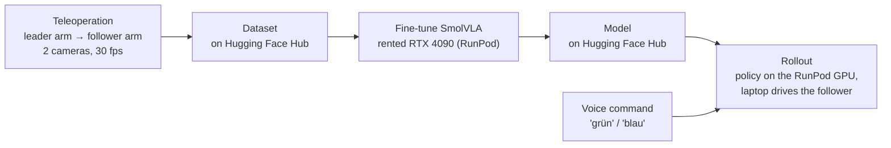

# VLA_Trial: teaching a robot arm to follow language instructions

A hobby experiment in **vision-language-action (VLA) models** on low-cost hardware. A
[SO-101](https://github.com/TheRobotStudio/SO-ARM100) robot arm is given a plain-English command
and has to pick the right block:

> *"Pick up the **green** block and put it in the red box."*
> *"Pick up the **blue** block and put it in the red box."*

The policy is [SmolVLA](https://huggingface.co/lerobot/smolvla_base), a 450M-parameter VLA from
Hugging Face, fine-tuned on demonstrations I recorded myself with
[LeRobot](https://github.com/huggingface/lerobot).

## The idea

Most beginner robot-learning demos teach a single motion: "pick up the thing". Here **both blocks are
always on the table**, and only the one named in the command goes into the box. To do the task, the
model has to read the instruction and connect the colour word to what it sees in the camera images.
Copying the motions it saw during training is not enough.

## How it works



1. **Record:** I move a *leader* arm by hand while the *follower* arm copies it. Two cameras (one from
   above, one from the side) and the joint positions are recorded at 30 fps, together with the
   language instruction for that episode.
2. **Train:** The laptop has no NVIDIA GPU, so SmolVLA is fine-tuned on a rented RTX 4090 on RunPod
   (about 3 hours for 20,000 steps, ≈ $3). Checkpoints go to the Hugging Face Hub every 2000 steps.
3. **Run:** The fine-tuned model controls the follower arm on its own, given only the camera images,
   the joint state and the instruction. On the laptop CPU one prediction takes 53 s, far too slow
   for a prediction every 1.7 s, so the model runs on the RunPod GPU (0.1 s per prediction) as a
   LeRobot *policy server*. The laptop sends the camera images through an SSH tunnel and moves the
   arm with the actions that come back.
4. **Talk to it:** a German voice command (*"grün"*, *"blau"*, *"stopp"*), recognised offline by
   Windows, sets the instruction, even while the arm is moving.

## Results so far

- Training: 20,000 steps (batch 64) in about 3 hours on an RTX 4090, ≈ $3.30 in total.
- Offline check on recorded frames: the predicted motions follow the demonstrations closely, and
  swapping the colour in the instruction changes the planned motion.
- On the robot: the task works in principle, more reliably with the **blue** block than with the
  green one.

## Dataset

📦 **[JRrobots4all/so101_blocks_into_box](https://huggingface.co/datasets/JRrobots4all/so101_blocks_into_box)** on the Hugging Face Hub

| | |
|---|---|
| Format | LeRobot dataset v3.0 |
| Robot | SO-101 follower (6 joints including gripper), teleoperated with an SO-101 leader |
| Cameras | `top` (angled from above) and `side` (from the front/side), 640×480 @ 30 fps |
| Tasks | 2 language instructions (green block / blue block) |
| Size | 60 episodes, ~20k frames (~11.5 min), and growing |

You can browse the episodes in the browser with the
[LeRobot dataset visualizer](https://huggingface.co/spaces/lerobot/visualize_dataset).

## Hardware

- SO-101 leader + follower arm pair
- Two USB kit cameras on desk clamps
- A Windows laptop without a dedicated GPU (recording, robot control, speech recognition)
- An RTX 4090 rented on RunPod (training and inference)
- Two wooden blocks (green and blue), a round red box, and masking tape to mark the workspace

## Repository layout

```
scripts/config.bat          Ports, camera IDs, pod address, Hugging Face repo names, task strings
scripts/find_cameras.py     Find the kit cameras' current OpenCV indices by USB ID
scripts/preview_cameras.py  Live camera preview for aiming and focusing the cameras
scripts/record.bat          Record teleoperated demonstrations
scripts/record_cues.py      lerobot-record wrapper with instant audio cues
scripts/rollout_remote.bat  Run the policy on the robot, inference on the RunPod GPU
scripts/voice_control.py    Voice control ("grün", "blau", "stopp") for rollout_remote.bat voice
scripts/rollout.bat         Run the policy with inference on the laptop CPU (too slow, reference only)
runpod/setup.sh             One-time LeRobot setup on the RunPod GPU pod
runpod/train.sh             Fine-tune SmolVLA (20,000 steps, checkpoints to the Hub)
runpod/autostop.sh          Stop the pod automatically when training has ended
runpod/serve.sh             Start the policy server (final model or a checkpoint)
runpod/server.yaml          Policy server configuration (model, robot schema, cameras)
```

## Reproducing it

Step-by-step setup, recording guidelines, training and rollout are in
**[DEVELOPMENT.md](DEVELOPMENT.md)**.

## Built with

- [LeRobot](https://github.com/huggingface/lerobot) by Hugging Face: recording, training and inference
- [SmolVLA](https://huggingface.co/blog/smolvla): the base vision-language-action model
- [SO-ARM100 / SO-101](https://github.com/TheRobotStudio/SO-ARM100) by The Robot Studio: the open-source arm
